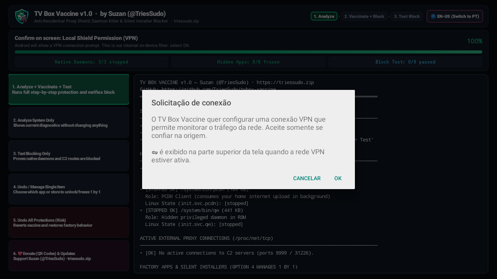
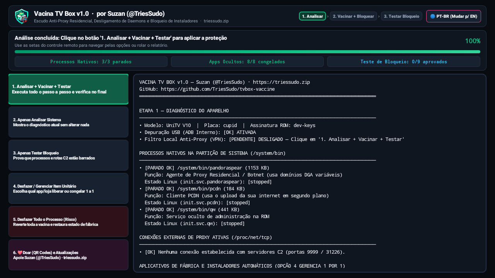
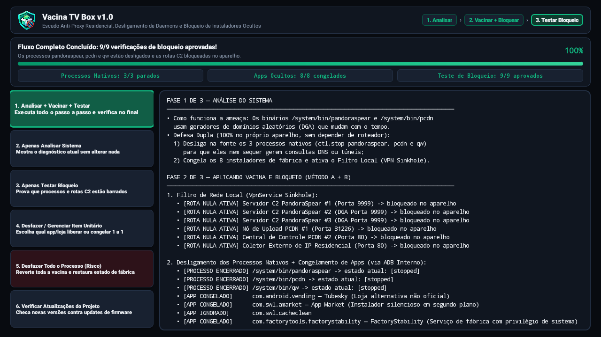

# 🛡️ TV Box Vaccine (Vacina TV Box) — v1.0

**On-Device Anti-Residential Proxy Shield, Root Daemon Killer & Silent Installer Blocker for Android TV Boxes**  
*Escudo Anti-Proxy Residencial, Desligamento de Daemons Nativos e Bloqueador de Instaladores Ocultos para Android TV Box*

**Created by Suzan ([@TriesSudo](https://github.com/TriesSudo))** · 🌐 **[triessudo.zip](https://triessudo.zip)** · ✉️ **triessudo@atomicmail.io**

[**🇺🇸 English Guide (Main)**](#-english-guide-en-us) · [**🇧🇷 Guia em Português (PT-BR)**](#-guia-em-português-pt-br) · [**💖 Donate / Apoie**](#-support-my-work--donate-crypto)

---

## 🇺🇸 English Guide (EN-US)

### 📥 Direct Download (v1.0)
- 👉 **[Download `TVBoxVaccine.apk` (v1.0)](https://github.com/TriesSudo/tvbox-vaccine/releases/latest/download/TVBoxVaccine.apk)** *(or grab [`TVBoxVaccine.apk`](./TVBoxVaccine.apk) / [`VacinaTVBox.apk`](./VacinaTVBox.apk) directly from this repository root).*
- 🌐 **Multi-Language Automatic Detection:** The app automatically detects your Android TV language (**English US/UK** or **Portuguese PT-BR**) and also includes a 1-click language switch button in the top bar.

> ⚠️ **Important Note on Future Firmware Updates:**  
> Some TV Box vendors push OTA firmware updates that try to re-enable hidden proxy daemons or add new command-and-control (C2) servers. Always check the **[Releases page](https://github.com/TriesSudo/tvbox-vaccine/releases)** (or press **Option 6** inside the app) to get the latest vaccine version if your device receives a malicious update.

---

### 🖥️ App Interface Preview

| 🇺🇸 English Interface (`EN-US`) | 🇧🇷 Portuguese Interface (`PT-BR`) |
| :---: | :---: |
|  |  |

---

### 🔍 What Does TV Box Vaccine Neutralize?

Many popular Android TV Boxes (such as Allwinner H616/H313 boards, UniTV V10, and similar ROMs) ship with hidden native binaries in `/system/bin` and silent background installers that turn your home internet connection into a commercial residential proxy node without your consent:

1. **`/system/bin/pandoraspear` (Residential Proxy / Botnet Agent with DGA):**
   - Connects outbound on TCP port `9999` to external Command & Control (C2) servers and sells your residential IP bandwidth to third parties.
   - Uses a **Domain Generation Algorithm (DGA)** so its domains change over time.
2. **`/system/bin/pcdn` (Hidden Peer-to-Peer CDN Daemon):**
   - Continuously consumes your home upload bandwidth in the background (`port 31226`).
3. **`/system/bin/qw` (Hidden Privileged ROM Daemon):**
   - Background root daemon started at boot.
4. **Silent Background APK Installers & Factory Bloatware:**
   - Packages like `com.swl.amarket` (*App Market*), `com.android.vending` (*unofficial modified Tubesky store*), `com.swl.cacheclean`, `com.softwinner.update`, `com.factorytools.factorystability`, `com.softwinner.dragonbox`, `com.softwinner.agingdragonbox`, and `com.softwinner.awlogsettings` that silently install unwanted APKs overnight.

---

### 🛡️ How the 3-Phase Protection Works (`1. Analyze › 2. Vaccinate + Block › 3. Test Block`)

Everything runs **100% inside the TV Box itself** — no computer and no router configuration required:

1. **Phase 1 — Analyze System:**
   - Checks USB Debugging status, inspects `/system/bin` daemons, audits `/proc/net/tcp` for active C2 sockets, and lists all hidden factory packages.
2. **Phase 2 — Vaccinate + Block (Dual Defense Method A + B):**
   - **Method A (Kill Daemons at Source + Freeze Installers):** Connects to the device's own internal ADB (`127.0.0.1:5555`), sends `ctl.stop` to terminate `pandoraspear`, `pcdn`, and `qw` in memory (stopping DGA domain generation at the source), and freezes all 8 silent installer packages (`pm disable-user --user 0`).
   - **Method B (Local Network Shield — VPN Sinkhole):** Establishes a lightweight local null-route (`VpnService`) that blackholes known C2 server routes on-device **without slowing down your internet speed** and **without touching your normal apps**.
3. **Phase 3 — Automatic Blocking Verification (`9/9 Checks`):**
   - Confirms all 3 native daemons are `stopped` and runs 6 live TCP socket tests to prove on screen that C2 connections are blocked.

---

### 🎛️ Full User Control & Reversibility (Options 4, 5 & 6)

- **Option 4 — Undo / Manage Single Item (1 by 1):**  
  Opens an interactive list showing each of the 8 factory packages individually (`🔒 FROZEN` or `🔓 UNLOCKED`). You can unlock or freeze any single item on demand (for example, temporarily unlocking *App Market* to update an app and freezing it again right after).
- **Option 5 — Undo All Protections (With Security Risk Warning):**  
  Displays a clear security warning and, if confirmed, reverts 100% of the vaccine changes back to factory defaults.
- **Option 6 — 💖 Donate (On-Screen QR Codes) & Check Updates:**  
  Displays hardcoded **BTC, ETH, and SOL QR Codes** right on your TV screen so you can support the project, links to **[triessudo.zip](https://triessudo.zip)** for additional coins, and checks GitHub for newer releases.

---

### 🚀 Step-by-Step USB Flash Drive Installation Guide (EN-US)

1. Download **[`TVBoxVaccine.apk`](https://github.com/TriesSudo/tvbox-vaccine/releases/latest/download/TVBoxVaccine.apk)** and copy it to a **USB Flash Drive**.
2. Plug the USB drive into your TV Box, open the **File Manager** app, and install `TVBoxVaccine.apk`.
3. **Enable USB Debugging** on your TV Box (only needed once):
   - Go to **Settings** $\rightarrow$ **Device Preferences** $\rightarrow$ **About** and click **Build number** **7 times** until it says *"You are now a developer"*.
   - Go back one screen, open **Developer Options**, and turn ON **USB Debugging**.
4. Open **TV Box Vaccine** and click **`1. Analyze + Vaccinate + Test`**.
5. When Android displays the **Connection request (VPN)** and **Allow USB debugging?** prompts, check **"Always allow from this computer"** and press **OK** on your remote.
6. Done! The top scoreboard will show **`Native Daemons: 3/3 stopped`**, **`Hidden Apps: 8/8 frozen`**, and **`Block Test: 9/9 passed`**.

---

## 🇧🇷 Guia em Português (PT-BR)

### 📥 Download Direto (v1.0)
- 👉 **[Baixar `VacinaTVBox.apk` / `TVBoxVaccine.apk` (v1.0)](https://github.com/TriesSudo/tvbox-vaccine/releases/latest/download/TVBoxVaccine.apk)**
- 🌐 **Detecção Automática de Idioma:** O aplicativo reconhece automaticamente se o Android da sua TV Box está em **Português (`PT-BR`)** ou **Inglês (`EN-US`)**, e também possui um botão no topo para alternar o idioma com 1 clique.

### 🚀 Como Instalar pelo Pendrive (Passo a Passo)

1. Baixe o arquivo **[`TVBoxVaccine.apk`](https://github.com/TriesSudo/tvbox-vaccine/releases/latest/download/TVBoxVaccine.apk)** (ou [`VacinaTVBox.apk`](./VacinaTVBox.apk)) e coloque em um **Pendrive**.
2. Conecte o pendrive na TV Box, abra o aplicativo **Arquivos** (*File Manager*) e instale o APK.
3. **Ative a Depuração USB** na TV Box (necessário apenas na primeira vez):
   - Vá em **Configurações** $\rightarrow$ **Preferências do Dispositivo** $\rightarrow$ **Sobre** e clique **7 vezes** em **Número da versão** até ativar o modo desenvolvedor.
   - Volte uma tela, entre em **Opções do desenvolvedor** e ative **Depuração USB**.
4. Abra o app **Vacina TV Box** e clique no **Botão 1 (`1. Analisar + Vacinar + Testar`)**.
5. Confirme o aviso de **Conexão VPN** (nosso filtro local) e, quando aparecer **Permitir depuração USB?**, marque **"Sempre permitir deste computador"** e clique em **OK**.
6. Pronto! O placar mostrará **`Processos Nativos: 3/3 parados`**, **`Apps Ocultos: 8/8 congelados`** e **`Teste de Bloqueio: 9/9 aprovados`**.
   - Na **Opção 4**, você pode desfazer/liberar qualquer aplicativo de fábrica de forma **unitária (1 por 1)**.
   - Na **Opção 5**, você pode **desfazer todo o processo** (com alerta de risco ao usuário).
   - Na **Opção 6**, você visualiza os **3 QR Codes de doação na tela da TV** e verifica se há novas atualizações.

---

## 💖 Support My Work / Donate (Crypto)

If this project protected your TV Box and home network from residential proxy botnets, please consider supporting **Suzan (`@TriesSudo`)**!  
*Se este projeto protegeu sua TV Box e sua internet residencial, considere apoiar meu trabalho com qualquer valor!*

🌐 **Want to donate with other cryptocurrencies?** Visit **[https://triessudo.zip](https://triessudo.zip)** for more coins and projects!

### 🟠 Bitcoin (BTC)
`bc1qpe2uwvtjkyuu7ntt5rnsnv823cdmc66t45q9wg`

---

### 🟣 Ethereum (ETH / ERC-20 / Base / Arbitrum / Polygon)
`0x88f633DAd7830e6512634445028979c6d2dF60Da`

---

### 🟢 Solana (SOL)
`G6NgGBpvAtazdpKn1tcBvcPztBgoxbi2hXgxV4aiaAQD`

---

## 📬 Contact & Links — Suzan (`@TriesSudo`)

- 🌐 **Website:** [https://triessudo.zip](https://triessudo.zip)
- ✉️ **Email:** [triessudo@atomicmail.io](mailto:triessudo@atomicmail.io)
- 💬 **Telegram:** [https://t.me/triessudo](https://t.me/triessudo)
- 🐦 **X (Twitter):** [https://x.com/TriesSudo](https://x.com/TriesSudo) (`@TriesSudo`)
- 💻 **GitHub:** [https://github.com/TriesSudo](https://github.com/TriesSudo)
