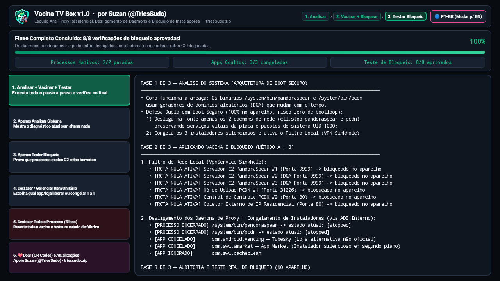
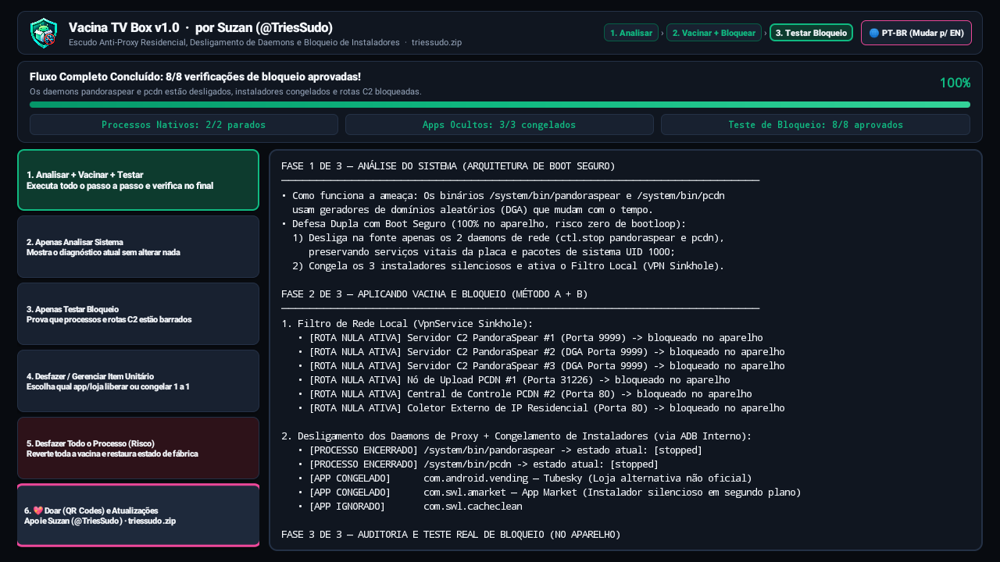
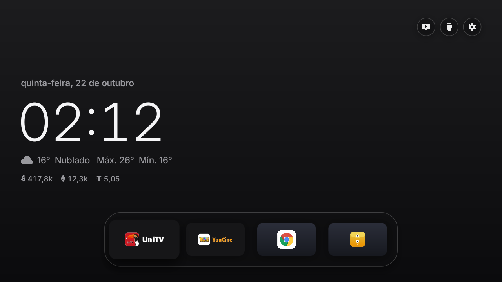

# 🛡️ TV Box Vaccine (Vacina TV Box) 💉 v1.0

**On-Device Anti-Residential Proxy Shield, Native Daemon Killer & Silent Installer Blocker for Android TV Boxes**  
*Escudo Anti-Proxy Residencial, Desligamento de Daemons Nativos e Bloqueador de Instaladores Ocultos para Android TV Box*

**Created by Suzan ([@TriesSudo](https://github.com/TriesSudo))** · 🌐 **[triessudo.zip](https://triessudo.zip)** · ✉️ **triessudo@atomicmail.io**

[**🇺🇸 English Guide (Main)**](#-english-guide-en-us) · [**🇧🇷 Guia em Português (PT-BR)**](#-guia-em-português-pt-br) · [**💖 Donate / Apoie**](#-support-my-work--donate-crypto)

---

## 🇺🇸 English Guide (EN-US)

### 📦 Direct Download (v1.0)
- 🚀 **[Download `TVBoxVaccine.apk` (v1.0)](https://github.com/TriesSudo/tvbox-vaccine/releases/latest/download/TVBoxVaccine.apk)** *(or grab [`TVBoxVaccine.apk`](./TVBoxVaccine.apk) / [`VacinaTVBox.apk`](./VacinaTVBox.apk) directly from this repository root).*
- 🌐 **Automatic Language Detection:** The app automatically detects your Android TV system language (**English US/UK** or **Portuguese PT-BR**) and includes a 1-click language switch toggle button in the top bar.

> ⚠️ **Important Note on Future Firmware Updates:**  
> Some TV Box vendors push OTA firmware updates that attempt to restore proxy daemons or add new command-and-control (C2) servers. Always check the **[Releases page](https://github.com/TriesSudo/tvbox-vaccine/releases)** (or press **Option 6** inside the app) to get the latest vaccine version whenever your device receives a system update.

---

### 🖥️ App Interface Preview (Verified on Real UniTV Box)

| 🇺🇸 English Interface (`EN-US`) | 🇧🇷 Portuguese Interface (`PT-BR`) |
| :---: | :---: |
|  |  |

| 💖 On-Screen Crypto Donate Modal (Option 6) | ⚙️ Single Package Manager (Option 4) |
| :---: | :---: |
|  |  |

---

### 🔍 What Does TV Box Vaccine Neutralize?

Many popular Android TV Boxes (such as Allwinner H616/H313 boards, UniTV V10, and similar firmware) ship with hidden background daemons in `/system/bin` and silent installers that turn your home internet into a commercial residential proxy without your consent:

1. **`/system/bin/pandoraspear` (Residential Proxy / Botnet Agent with DGA):**
   - Connects outbound on TCP port `9999` to external Command & Control (C2) servers and sells your residential IP bandwidth to third parties.
   - Uses a **Domain Generation Algorithm (DGA)** so its domains dynamically change over time.
2. **`/system/bin/pcdn` (Hidden Peer-to-Peer CDN Daemon):**
   - Continuously consumes your home internet upload bandwidth in the background (`port 31226`).
3. **Silent Background APK Installers:**
   - Third-party packages such as `com.android.vending` (*unofficial modified Tubesky store*), `com.swl.amarket` (*App Market*), and `com.swl.cacheclean` that execute silent APK installations overnight.
4. **Boot-Safe System Architecture:**
   - Core board and system services (`com.softwinner.update`, `com.factorytools.factorystability`, `qw`) are **never disabled**, eliminating any risk of bootloops or Android `RescueParty` triggers.

---

### 🚀 Visual Pipeline: 1. Analyze ➔ 2. Vaccinate + Block ➔ 3. Test Block

When you click **Button 1 (`1. Analyze + Vaccinate + Test`)**, the app executes the full visual workflow with a live progress bar (`0%–100%`) and status text:

1. **Phase 1 — Analyze System:**
   - Checks USB Debugging status, inspects `/system/bin` native daemons, audits `/proc/net/tcp` for active C2 sockets, and inspects factory installer packages.
2. **Phase 2 — Vaccinate + Block (Boot-Safe Dual Defense):**
   - **Method A (Stop Daemons at Source + Freeze Installers):** Connects to the device's own internal debugging service (`127.0.0.1:5555`), sends `ctl.stop` to terminate `pandoraspear` and `pcdn` in memory (cutting off DGA domain generation at the root), and safely freezes non-system silent installers (`pm disable-user --user 0`).
   - **Method B (Local Anti-Proxy Shield — VPN Sinkhole):** Establishes a lightweight local null-route (`VpnService`) that blackholes known C2 server routes on-device **without slowing down your internet speed** and **without touching normal streaming apps**.
3. **Phase 3 — On-Device Verification Audit (`8/8 Checks Passed`):**
   - Verifies that both native proxy daemons are `stopped` and performs 6 live TCP socket tests directly on the box to confirm C2 routes are blocked.

---

### 🎛️ Full User Control & Reversibility (Options 4, 5 & 6)

- **Option 4 — Undo / Manage Single Item (1 by 1):**  
  Opens an interactive dialog allowing you to unlock/enable or freeze each factory installer package individually.
- **Option 5 — Undo All Protections (Factory Restore with Safety Warning):**  
  Displays a clear security warning and, if confirmed, reverts all protections back to factory default state.
- **Option 6 — 💖 Donate (On-Screen QR Codes) & Check Updates:**  
  Displays hardcoded **BTC, ETH, and SOL QR Codes** directly on your TV screen so you can support the project, links to **[triessudo.zip](https://triessudo.zip)** for additional coins, and checks GitHub for newer releases.

---

### 📥 Step-by-Step USB Drive Installation Guide (EN-US)

1. Download **[`TVBoxVaccine.apk`](https://github.com/TriesSudo/tvbox-vaccine/releases/latest/download/TVBoxVaccine.apk)** and copy it to a **USB Flash Drive**.
2. Plug the USB drive into your TV Box, open the **File Manager** app, and install `TVBoxVaccine.apk`.
3. **Enable USB Debugging** on your TV Box (only needed once):
   - Go to **Settings** $\rightarrow$ **Device Preferences** $\rightarrow$ **About** and click **Build number** **7 times** until it says *"You are now a developer"*.
   - Go back one screen, open **Developer Options**, and turn ON **USB Debugging**.
4. Open **TV Box Vaccine** and click **`1. Analyze + Vaccinate + Test`**.
5. When Android displays the **Connection request (VPN)** and **Allow USB debugging?** prompts, check **"Always allow from this computer"** and press **OK** on your remote.
6. Done! The scoreboard will confirm **`Native Daemons: 2/2 stopped`**, **`Hidden Apps: 3/3 frozen`**, and **`Block Test: 8/8 passed`**.

---

## 🇧🇷 Guia em Português (PT-BR)

### 📦 Download Direto (v1.0)
- 🚀 **[Baixar `VacinaTVBox.apk` / `TVBoxVaccine.apk` (v1.0)](https://github.com/TriesSudo/tvbox-vaccine/releases/latest/download/TVBoxVaccine.apk)**
- 🌐 **Detecção Automática de Idioma:** O aplicativo reconhece automaticamente se o Android da sua TV Box está em **Português (`PT-BR`)** ou **Inglês (`EN-US`)**, além de possuir um botão no topo para alternar o idioma com 1 clique.

---

### 📥 Como Instalar pelo Pendrive (Passo a Passo)

1. Baixe o arquivo **[`TVBoxVaccine.apk`](https://github.com/TriesSudo/tvbox-vaccine/releases/latest/download/TVBoxVaccine.apk)** (ou [`VacinaTVBox.apk`](./VacinaTVBox.apk)) e copie para um **Pendrive**.
2. Conecte o pendrive na TV Box, abra o aplicativo de arquivos e instale o APK.
3. **Ative a Depuração USB** na TV Box (apenas na primeira vez):
   - Vá em **Configurações** $\rightarrow$ **Preferências do Dispositivo** $\rightarrow$ **Sobre** e clique **7 vezes** em **Número da versão** até liberar o modo desenvolvedor.
   - Volte uma tela, abra **Opções do desenvolvedor** e ative **Depuração USB**.
4. Abra o app **Vacina TV Box** e clique no botão **`1. Analisar + Vacinar + Testar`**.
5. Confirme o pedido de **Conexão VPN** (nosso filtro local) e, quando aparecer a mensagem **Permitir a depuração USB?**, marque **"Sempre permitir a partir deste computador"** e confirme com **OK** no controle.
6. Pronto! O placar mostrará **`Processos Nativos: 2/2 parados`**, **`Apps Ocultos: 3/3 congelados`** e **`Teste de Bloqueio: 8/8 aprovados`**.
   - Na **Opção 4**, você pode liberar ou congelar pacotes individualmente **(1 por 1)**.
   - Na **Opção 5**, você pode **desfazer todo o processo** (com alerta de risco).
   - Na **Opção 6**, você visualiza os **3 QR Codes de doação na TV** e consulta atualizações no GitHub.

---

## 💖 Support My Work / Donate (Crypto)

If this project protected your TV Box and home network from residential proxy botnets, please consider supporting **Suzan (`@TriesSudo`)**!  
*Se este projeto protegeu sua TV Box e sua internet residencial contra botnets de proxy, apoie com qualquer valor!*

🌐 **Want to donate with other cryptocurrencies?** Visit **[https://triessudo.zip](https://triessudo.zip)** for more coins and projects!

### 🪙 Bitcoin (BTC)
`bc1qpe2uwvtjkyuu7ntt5rnsnv823cdmc66t45q9wg`

---

### 🪙 Ethereum (ETH / ERC-20 / Base / Arbitrum / Polygon)
`0x88f633DAd7830e6512634445028979c6d2dF60Da`

---

### 🪙 Solana (SOL)
`G6NgGBpvAtazdpKn1tcBvcPztBgoxbi2hXgxV4aiaAQD`

---

## 📬 Contact & Links — Suzan (`@TriesSudo`)

- 🌐 **Website:** [https://triessudo.zip](https://triessudo.zip)
- ✉️ **Email:** [triessudo@atomicmail.io](mailto:triessudo@atomicmail.io)
- 💬 **Telegram:** [https://t.me/triessudo](https://t.me/triessudo)
- 🐦 **X (Twitter):** [https://x.com/TriesSudo](https://x.com/TriesSudo) (`@TriesSudo`)
- 💻 **GitHub:** [https://github.com/TriesSudo](https://github.com/TriesSudo)
